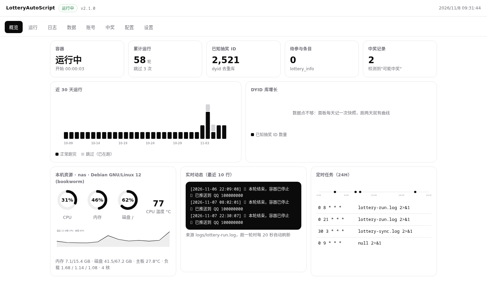

# B站抽奖自动化 · 二改版

> 在上游一次性脚本之上，加了一套**常驻 Docker 的可视化控制台**：
> 把「跑一轮 / 看日志 / 改配置 / 定时 / 中奖 / 数据」全部搬进浏览器。

<p align="center">
  
</p>

<p align="center">
  
  
  
  
  
</p>

---

## 这是什么

这是 [shanmiteko/LotteryAutoScript](https://github.com/shanmiteko/LotteryAutoScript) 的**个人二改分支**。
抽奖内核保持上游实现不动，本分支只做三件事：

1. **加了一层 Web 控制台** —— `panel/`，Python 标准库单文件后端 + 纯手写 SVG 图表，无框架、无 CDN、断网可用
2. **定时任务从 root crontab 迁到 `/etc/cron.d`** —— 由面板统一管理，面板重启不影响调度
3. **补齐运维细节** —— 日志中文标注、CPU/内存/磁盘环形图、运行趋势、中奖记录、操作审计

> 上游是「一次性脚本 + 自己维护 crontab」；二改版是「常驻面板 + 点按钮」。
> 只想跑脚本直接看上游；想可视化运维再用这个分支。
> 上游的完整配置说明（COOKIE 获取、推送、青龙等）保留在 **[README.upstream.md](README.upstream.md)**。

---

## 面板功能

| 页面 | 内容 |
|:--|:--|
| **概览** | 容器状态、累计轮次、dyid 库、待参与条目、中奖数；近 30 天运行柱状图、dyid 增长曲线、CPU/内存/磁盘三环、CPU 温度、CPU 采样曲线、24h 定时时间线、最近 10 行实时动态 |
| **运行** | 跑一轮 / 停止 / 中奖检测 / 清理过期数据 / 同步上游 / 重建镜像；按天数清理转发动态；最近运行表 |
| **日志** | 四个日志切换、中文标注、关键字过滤、自动刷新、一键下载 |
| **数据** | dyid 计数与查询、lottery_info 明细、导出 dyid.txt / my_config.js / 运行日志 |
| **账号** | 解析 `env.js` 账号列表（备注 / UID / CLEAR / Cookie 完整性）、B站登录二维码 |
| **中奖** | winner-check 解析出的「可能中奖」时间线 |
| **配置** | `my_config.js` 在线编辑，保存前 `node --check` 校验并自动备份；`env.js` 敏感值打码只读 |
| **设置** | 定时任务编辑（含模板）、安全说明、改密码、配置备份/恢复、QQ 推送测试、面板自更新、上游版本、操作审计 |

---

## 快速开始

前提：宿主已装 Docker，且已有 `lottery-auto-script:bili` 镜像（按上游 `script/` 构建）。

```bash
git clone https://github.com/wangixangya/LotteryAutoScript.git
cd LotteryAutoScript/panel

DOCKER_BUILDKIT=0 docker build -t lottery-panel:2.1.0 .

docker run -d --name lottery-panel --restart unless-stopped --network host \
  -v /var/run/docker.sock:/var/run/docker.sock \
  -v /root/lottery-docker:/app/lottery \
  -v /root/LotteryAutoScript:/app/src \
  -v /etc/cron.d:/etc/cron.d \
  -v /:/host:ro \
  -e TZ=Asia/Shanghai \
  -e LOTTERY_HOST=/root/lottery-docker \
  -e HOST_ROOT=/host \
  lottery-panel:2.1.0
```

打开 `http://<NAS-IP>:5311`，默认密码 `admin`（写在 `panel/panel.conf`）。

### 挂载点为什么这么写

| 挂载 | 用途 |
|:--|:--|
| `/var/run/docker.sock` | 面板用 docker CLI 遥控抽奖容器（面板自己不含抽奖逻辑） |
| `/root/lottery-docker` | 脚本、`my_config.js`、`env.js`、`data/`、`logs/` |
| `/etc/cron.d` | 定时写 `lottery-panel` 文件，宿主 cron 每分钟读取 |
| `/:/host:ro` | 读**真主机**的主机名 / 发行版 / 磁盘；否则读到的全是容器自己（主机名变容器 ID、磁盘变 955GB overlay） |

`--network host` 让面板能直连宿主 `127.0.0.1` 上的 NapCat 推送通道；`-e LOTTERY_HOST` 必须是**宿主路径**，因为 docker CLI 操作的是宿主 docker。

---

## 定时任务

面板「设置 → 定时任务」写入 `/etc/cron.d/lottery-panel`：

```
0 8 * * *   root /bin/bash /root/lottery-docker/run.sh >> /var/log/lottery-run.log 2>&1
0 21 * * *  root /bin/bash /root/lottery-docker/run.sh >> /var/log/lottery-run.log 2>&1
30 3 * * *  root /bin/bash /root/lottery-docker/sync-and-update.sh >> /var/log/lottery-sync.log 2>&1
0 9 * * *   root /bin/bash /root/lottery-docker/winner-check.sh >/dev/null 2>&1
```

默认 `08:00 / 21:00` 各跑一轮、`03:30` 同步上游、`09:00` 中奖检测。

> cron 里 `%` 是换行符，面板写入时自动转义成 `\%`。手写 crontab 时写 `date +\%H`，否则命令会被截断。

---

## 目录结构

```
panel/                 # 二改新增：Web 控制台
  server.py            # 单文件后端（标准库，零依赖）
  index.html           # 前端（无框架 / 无 CDN / 手写 SVG 图表）
  Dockerfile           # alpine + docker-cli + python3
  recreate.sh          # 重建镜像并替换容器（面板自更新用）
lib/  script/  test/   # 上游抽奖内核，未改动
README.upstream.md     # 上游原始文档（COOKIE、推送、青龙等）
```

---

## 安全提醒

- 面板持有 `docker.sock`，**等同宿主 root**，不要把 5311 暴露到公网
- 内置限制：只允许内网 / 本机 IP，公网 IP 一律 403；登录连续失败 5 次锁 10 分钟
- `env.js` 的 COOKIE 只存在宿主文件里，面板只显示长度与字段完整性
- 默认密码 `admin`，部署后请自行修改

---

## English

A personal fork of [LotteryAutoScript](https://github.com/shanmiteko/LotteryAutoScript) with a
**self-hosted web console** (`panel/`, Python stdlib backend and hand-rolled SVG charts — no
frameworks, no CDN, works offline).

What's added: a persistent Docker panel (overview / run / logs / data / accounts / winners / config /
settings), cron jobs moved into `/etc/cron.d` and managed from the panel, Chinese log annotations,
per-host metrics read through a read-only `/:/host` mount, and one-click self-update.

The lottery engine is untouched upstream code. Full upstream documentation lives in
[README.upstream.md](README.upstream.md).

**Personal modification for learning and self-hosting. Use at your own risk and respect Bilibili's
terms of service.**

---

## 致谢

- 内核：[shanmiteko/LotteryAutoScript](https://github.com/shanmiteko/LotteryAutoScript) · MIT
- 面板：本分支自建 · MIT
